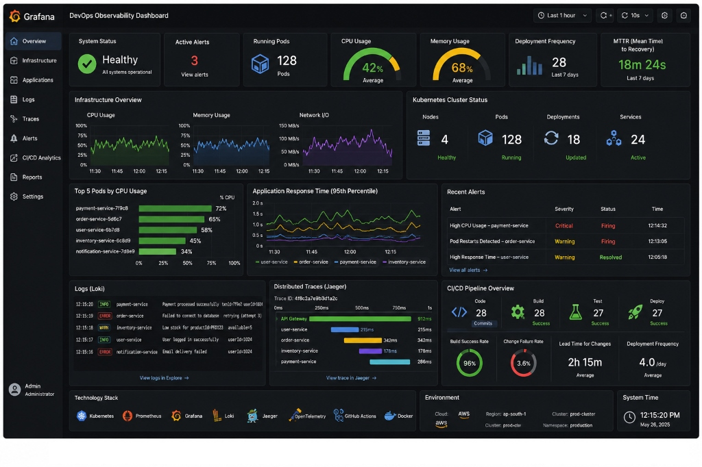

# Grafana DevOps Observability Dashboard

A high-fidelity, interactive, pixel-perfect web implementation of the **Grafana DevOps Observability Dashboard**.



---

## ✨ Features & Architecture

### 1. **Header & Navigation Bar**
- **Brand Identity**: Official Grafana spiral vector logo and "DevOps Observability Dashboard" title.
- **Time Range Selector**: Interactive range picker (`Last 15 minutes`, `Last 1 hour`, `Last 3 hours`, `Last 24 hours`, `Last 7 days`) with dynamic chart recalculation.
- **Auto-Refresh Controls**: Animated sync button with countdown interval (`5s`, `10s`, `30s`, `1m`, `Off`).
- **Fullscreen Kiosk Mode**: One-click TV/wallboard presentation mode.
- **Left Sidebar**: 9 navigation categories (`Overview`, `Infrastructure`, `Applications`, `Logs`, `Traces`, `Alerts`, `CI/CD Analytics`, `Reports`, `Settings`) and user profile card.
  - **CI/CD Analytics Tab**: Clicking **CI/CD Analytics** opens the dedicated full-page **CI/CD & DORA Analytics Dashboard** in dark mode!
  - **Overview Tab**: Clicking **Overview** switches back to the primary DevOps Observability Dashboard with real-time streaming waveforms.

### 2. **Key Performance Indicators (Top 7 Stat Cards)**
1. **System Status**: Global operational status with glowing badge indicator.
2. **Active Alerts**: Firing alert counter with modal drilldown.
3. **Running Pods**: Real-time Kubernetes pod counter with isometric 3D cube icon.
4. **CPU Usage**: Animated radial semi-circular SVG gauge displaying cluster-wide average.
5. **Memory Usage**: Dynamic radial semi-circular SVG gauge displaying RAM utilization.
6. **Deployment Frequency**: Weekly deployment counter with micro-histogram.
7. **MTTR (Mean Time to Recovery)**: Green recovery velocity metric.

### 3. **Infrastructure Overview & Kubernetes Status**
- **Infrastructure Waveforms**: High-DPI Canvas charts for **CPU Usage**, **Memory Usage**, and **Network I/O** with interactive crosshair tooltips and area gradients.
- **Kubernetes Cluster Status**: Real-time status cards for Nodes (`4 Healthy`), Pods (`128 Running`), Deployments (`18 Updated`), and Services (`24 Active`).

### 4. **Application Performance & Alert Management**
- **Top 5 Pods by CPU**: Horizontal progress bars for high-utilization workloads (`payment-service`, `order-service`, `user-service`, `inventory-service`, `notification-service`).
- **Application Response Time (p95)**: Multi-line time-series chart comparing 4 microservices with colored legend and interactive point inspection.
- **Recent Alerts Table**: Status badges (`Critical`, `Warning`), firing states (`Firing`, `Resolved`), and click-to-acknowledge modal.

### 5. **Observability Pillars: Logs, Traces & CI/CD**
- **Logs (Loki)**: Terminal stream with color-coded severity tags (`INFO`, `WARN`, `ERROR`) and LogQL Explorer modal.
- **Distributed Traces (Jaeger)**: Interactive timeline waterfall chart with millisecond span inspection (`API Gateway`, `user-service`, `order-service`, `inventory-service`, `payment-service`).
- **CI/CD Pipeline Overview**: 4-stage pipeline tracker (`Code`, `Build`, `Test`, `Deploy`) with DORA metrics:
  - Circular SVG progress ring for **Build Success Rate (96%)**
  - Circular SVG progress ring for **Change Failure Rate (3.6%)**
  - **Lead Time for Changes (2h 15m)**
  - **Deployment Frequency (4.0 /day)**

### 6. **Technology Stack & Environment**
- **Technology Stack**: Vector brand logos for **Kubernetes**, **Prometheus**, **Grafana**, **Loki**, **Jaeger**, **OpenTelemetry**, **GitHub Actions**, and **Docker**.
- **Environment**: Cloud provider (**AWS**), Region (`ap-south-1`), Cluster (`prod-cluster`), and Namespace (`production`).
- **Live System Time**: Synchronized clock matching the exact timestamp (`12:15:20 PM May 26, 2025`) with a toggle to track real-world system time.

---

## 🚀 Getting Started

You can run this dashboard using **any** of the following methods without complex setup:

### Method 1: Instant Browser Opening (Zero Install)
Simply double-click `index.html` or open it in any web browser (Chrome, Edge, Firefox, Safari).

### Method 2: Python HTTP Server
```bash
python server.py
```
Open [http://localhost:3000](http://localhost:3000) in your browser.

### Method 3: Node.js
```bash
npm start
```
Open [http://localhost:3000](http://localhost:3000) in your browser.

---

## 🛠️ File Structure

```
├── index.html          # Semantic HTML5 dashboard layout & modal dialogs
├── css/
│   └── dashboard.css   # Grafana dark theme styling, layout grids, animations
├── js/
│   ├── icons.js        # Razor-sharp SVG icons for tools, cloud & system
│   ├── charts.js       # High-DPI Canvas & SVG time-series chart engine
│   └── app.js          # Live mock engine, auto-refresh, modals, and events
├── server.py           # Optional Python web server
├── package.json        # Optional Node.js runner script
└── README.md           # Documentation & user guide
```

